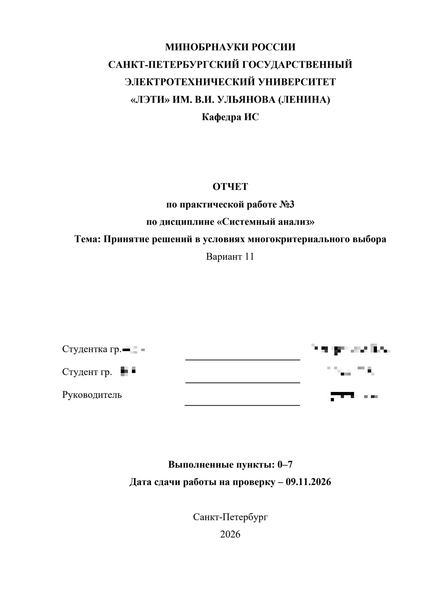
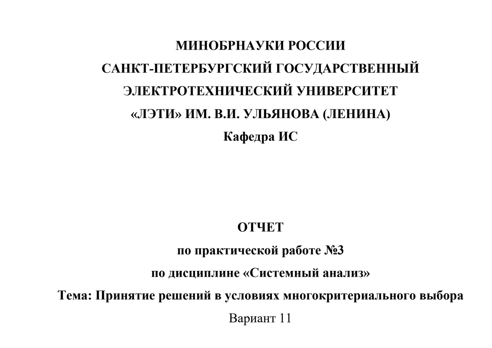

# Otchet – Skill làm báo cáo tiếng Nga cho Cline

Skill dùng để viết báo cáo học thuật bằng tiếng Nga cho **mọi môn học**:
báo cáo thực hành (ПР), лабораторная, реферат, курсовая, отчёт по практике,
НИР, МДП.

Skill đọc đề bài, tìm đúng variant, xem mẫu gần nhất, hỏi các thông tin còn
thiếu, viết báo cáo bằng tiếng Nga đơn giản, tạo DOCX/PDF và kiểm tra lại
định dạng trước khi giao.

## Điểm mạnh

- **Không cần VPN**: skill chạy hoàn toàn local, không gọi dịch vụ ngoài và
  không cần VPN để cài hoặc sử dụng. API AI do bạn cấu hình trong Cline.
- **Dùng cho mọi môn học**, không gắn với một môn cụ thể.
- Báo cáo viết bằng tiếng Nga; trao đổi với người dùng bằng tiếng Việt.
- Văn phong đơn giản, tự nhiên, tập trung vào việc đã làm và kết quả.
- Hỗ trợ báo cáo thực hành, lab, реферат, курсовая, отчёт по практике, НИР, МДП.
- Xuất DOCX/PDF và giữ bố cục theo mẫu báo cáo.
- **Trang bìa lấy font và cỡ chữ từ бланк** (Times New Roman 14 pt), không bị co
  theo preset của phần nội dung; `validate_docx.py` so từng dòng bìa với mẫu và
  báo FAIL khi lệch.
- **«Цель работы» là mục bắt buộc** với ПР/lab/НИР/практика: `goal_section()`,
  `save_report(..., require_goal=True)` và `validate_docx.py` chặn việc bỏ mất mục.
- Có thể dùng template riêng của trường/khoa hoặc thay bằng mẫu của bạn.

## Yêu cầu

- **Cline** – extension Cline trong VS Code.
- **API AI** – cấu hình API key trong Cline (OpenAI, Anthropic, OpenRouter,
  Google hoặc provider tương đương).
- **Python 3.10+** (đã kiểm với 3.14).
- **python-docx** (bắt buộc) + **lxml** (python-docx cần) – dựng DOCX.
- **pypdf** (bắt buộc) – `strip_metadata.py` xoá metadata PDF, kiểm annotation `/Link`.
- **pypdfium2** – `validate_docx.py` đọc/kiểm trang PDF và render ảnh.
- **Pillow** – chèn/kiểm hình minh hoạ.
- **Microsoft Word trên Windows** (COM) – xuất PDF/A, cập nhật field TOC,
  `Fields.Update()`; **không có Word thì chỉ ra DOCX** (TOC và PDF sẽ thiếu).
- **Font Times New Roman** – có sẵn trong Windows.

```powershell
python -m pip install python-docx pypdf pypdfium2 lxml pillow
python scripts\check_env.py      # kiểm tra toàn bộ môi trường, exit 0 = chạy được
```

Không cần: LaTeX/MiKTeX (chỉ dùng khi chèn `MathTex`, không thuộc skill này),
LibreOffice, pandoc, ffmpeg.

**Nếu thiếu gì:** `scripts/check_env.py` in ra danh sách thiếu kèm lệnh/link khắc
phục; agent phải **báo user và xin phép trước khi cài**, không tự `pip install`.
Không có MS Word thì chỉ ra DOCX (không có PDF và mục lục thật) – nói rõ trước.

## Cài đặt

### Cài global cho Cline

Clone repo trực tiếp vào thư mục skill toàn cục:

```powershell
git clone https://github.com/stoner-lab/Otchet.git "$HOME\.cline\skills\otchet"
```

Cline cũng quét `%USERPROFILE%\.agents\skills`, nên có thể dùng:

```powershell
git clone https://github.com/stoner-lab/Otchet.git "$HOME\.agents\skills\otchet"
```

### Cài trong workspace

```powershell
git clone https://github.com/stoner-lab/Otchet.git ".agents\skills\otchet"
```

hoặc:

```powershell
git clone https://github.com/stoner-lab/Otchet.git ".cline\skills\otchet"
```

Repo root chính là thư mục skill, nên clone trực tiếp thành thư mục `otchet`
là dùng được.

## Cách dùng

Trong Cline:

```text
/otchet
```

hoặc nói:

```text
Làm báo cáo môn <tên môn>, bài <số bài>, variant <số>, ...
```

Skill sẽ hỏi thêm họ tên, nhóm, giảng viên, hạn nộp và nơi lưu file nếu thiếu.
Mặc định skill viết từng phần và chờ xác nhận.

## Ảnh minh họa

Báo cáo ПР-3 dưới đây được tạo **100% bằng skill**, không có thao tác chỉnh
sửa thủ công. Ảnh được chụp từ file PDF do skill xuất ra. Tên và số nhóm
trong ảnh đã được che để bảo vệ thông tin cá nhân.

<p align="center">
  
</p>

<p align="center"><em>Trang bìa báo cáo ПР-3</em></p>

<p align="center">
  
</p>

<p align="center"><em>Phần đầu trang bìa</em></p>

## Template

Trang bìa mẫu nằm trong `assets/templates/title_page_leti.docx`. Có thể thay
bằng mẫu của trường/khoa bạn nếu cần.

## Repo

https://github.com/stoner-lab/Otchet

## License

MIT – xem file [`LICENSE`](LICENSE).
