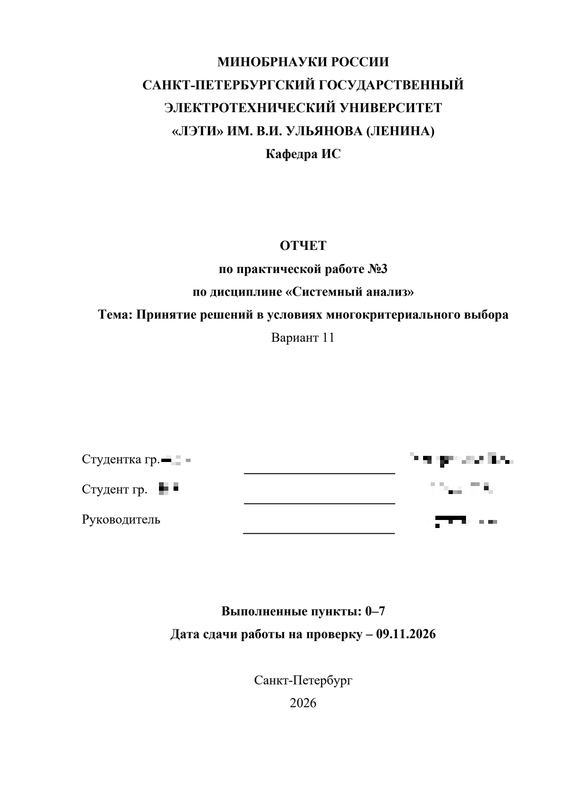

# otchet — учебные отчёты на русском для Cline

Навык (skill) для [Cline](https://cline.bot), который пишет университетские отчёты
**на русском языке** по любому предмету: ПР, лабораторная, реферат, курсовая,
отчёт по практике, НИР, МДП.

Навык читает задание, находит вариант, смотрит ближайший образец, спрашивает только
то, чего действительно не хватает, пишет текст простым русским языком, собирает
DOCX, экспортирует PDF через Microsoft Word и проверяет результат перед сдачей.

**Языки:** [English](README.md) | [Русский](README.ru.md) | [Tiếng Việt](README.vi.md)

## Что он делает хорошо

- **Любой предмет, любой вуз.** Ничего не зашито: предмет, кафедра, преподаватель,
  вариант и структура берутся из задания или от вас. ЛЭТИ — только титульный лист
  по умолчанию.
- **Работает 100% по методичке.** Дали методичку и больше ничего не сказали —
  выполняются все её требования, включая раздел «Рекомендации».
  *рекомендуется*, *следует*, *необходимо* — это требования, а не советы.
- **Спрашивает объём** для курсовой и НИР (30 / 50 / 70 или своё число) и
  распределяет страницы по главам до того, как начать писать.
- **Скриншоты по умолчанию.** Результаты, окна IDE, графики и платы снимаются,
  обрезаются до нужной области и вставляются как `Рис. N` со сквозной нумерацией.
  Код никогда не скриншотом: только текстом, с подводкой.
- **«Цель работы» не теряется.** `save_report(..., require_goal=True)` не сохраняет
  ПР без цели, а `validate_docx.py` проверяет это после сборки.
- **Титульный лист клонируется из бланка**, поэтому остаётся Times New Roman 14 пт,
  а не масштабируется под стиль основного текста.
- **Экспорт PDF не оставляет Word висеть**: `export_pdf_via_word()` использует уже
  открытый Word, закрывает только свою сессию и ждёт выхода.
- **Без VPN и без внешних сервисов.** Всё локально, модель — та, что настроена в Cline.

## Требования

| Что нужно | Зачем |
|---|---|
| Cline (VS Code или Desktop) | запускает навык |
| Python 3.10+ (проверено на 3.14) | скрипты |
| `python-docx`, `lxml` | сборка DOCX |
| `pypdf` | очистка метаданных PDF, проверка аннотаций `/Link` |
| `pypdfium2` | просмотр и рендер страниц PDF |
| `Pillow` | вставка и проверка иллюстраций |
| Microsoft Word на Windows | экспорт PDF, настоящий TOC, `Fields.Update()` |
| Times New Roman | есть в Windows |

```powershell
python -m pip install python-docx pypdf pypdfium2 lxml pillow
python scripts\check_env.py      # код 0 = окружение готово
```

Без Word вы всё равно получите DOCX, но не PDF и не настоящее оглавление — навык
скажет об этом до начала работы.

## Установка

Навык лежит в папке `otchet` репозитория
[Cline-Skills](https://github.com/stoner-lab/Cline-Skills). Скопируйте эту папку в
`%USERPROFILE%\.cline\skills\otchet`.

**Вариант 1 — разреженный клон (только этот навык):**

```powershell
git clone --depth 1 --filter=blob:none --sparse https://github.com/stoner-lab/Cline-Skills.git "$env:TEMP\cline-skills"
git -C "$env:TEMP\cline-skills" sparse-checkout set otchet
Copy-Item -LiteralPath "$env:TEMP\cline-skills\otchet" -Destination "$env:USERPROFILE\.cline\skills\otchet" -Recurse
```

**Вариант 2 — полный клон, затем копирование:**

```powershell
git clone https://github.com/stoner-lab/Cline-Skills.git "$env:TEMP\cline-skills"
Copy-Item -LiteralPath "$env:TEMP\cline-skills\otchet" -Destination "$env:USERPROFILE\.cline\skills\otchet" -Recurse
```

**Вариант 3 — ZIP:** *Code → Download ZIP*, распаковать и перенести папку `otchet`
в `%USERPROFILE%\.cline\skills\otchet`.

После этого перезапустите Cline или начните новую задачу, чтобы список навыков
обновился. В `INSTALL.md` описаны переменные `OTCHET_TEMPLATES`, `OTCHET_SKILL_DIR`
и то, как разрешаются относительные пути.

## Использование

```text
/otchet
```

или просто:

```text
Сделай ПР-3 по варианту 11, предмет «Статистический анализ», группа 3310
```

Навык спросит недостающее (ФИО, группа, преподаватель, срок, куда сохранять) и,
если не сказано иначе, пишет по разделам и ждёт подтверждения. Дайте только
методичку — и он пойдёт строго по ней.

## Как это работает

1. читает задание, находит вариант, смотрит образец отчёта;
2. сверяет числа, единицы и десятичные разделители с вариантом;
3. спрашивает недостающее, включая объём для длинных работ;
4. предлагает план с распределением страниц;
5. пишет разделы по одному;
6. собирает DOCX через `scripts\docx_helpers.py`;
7. экспортирует PDF через Word;
8. запускает `scripts\validate_docx.py` и сверяет реальное число страниц с планом;
9. печатает таблицу соответствия: каждое требование методички → где выполнено.

## Скрипты

| Скрипт | Назначение |
|---|---|
| `scripts\docx_helpers.py` | кирпичи: титульный лист, разделы, таблицы, рисунки с подписями, код, экспорт PDF |
| `scripts\validate_docx.py` | проверяет шрифт, поля, интервал, подписи, TOC, нумерацию страниц, титул по шаблону |
| `scripts\check_env.py` | перечисляет отсутствующие библиотеки, шрифты и шаблоны с командой для исправления |
| `scripts\selftest.py` | сквозной самотест на встроенном шаблоне |
| `scripts\strip_metadata.py` | удаляет метаданные автора из DOCX/PDF перед сдачей |
| `scripts\capture_window.ps1` | снимает одно окно приложения в PNG, учитывает DPI, `-Crop` / `-CropPercent` |
| `scripts\crop_image.ps1` | обрезает изображение по пикселям или доле, `-AutoTrim` убирает однотонные поля |

## Справочные материалы

`references/format.md` (оформление и ГОСТ), `references/report-types.md`
(структура по типам отчётов), `references/checklist.md` (чек-лист перед сдачей),
`references/extraction.md` (чтение задания и образца),
`references/templates.md` (шаблоны титульного листа).

## Скриншоты

Отчёт ПР-3, собранный **полностью навыком**, без ручной правки. Фамилия и номер
группы замазаны. Изображения взяты из PDF, который экспортировал навык.

<p align="center">
  
</p>

## Честные ограничения

- Не придумывает измерения и результаты: недостающие данные называет, а не заполняет.
- Сканы и фото страниц нужно проверять глазами; навык скажет, что не смог прочитать.
- Оформление: сначала задание, затем образец, затем встроенные значения по умолчанию.
- Сделано под Windows и PowerShell; для PDF нужен Word.

## Лицензия

MIT — см. [`LICENSE`](LICENSE). Часть коллекции
[Cline-Skills](https://github.com/stoner-lab/Cline-Skills).

