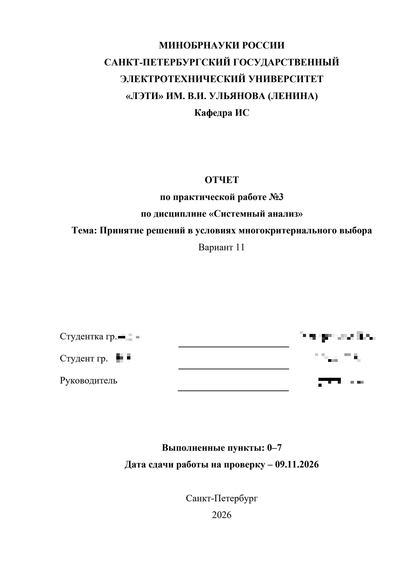

# otchet — báo cáo học tập tiếng Nga cho Cline

Skill cho [Cline](https://cline.bot) viết báo cáo đại học **bằng tiếng Nga** cho mọi
môn học: ПР (практическая работа), лабораторная, реферат, курсовая,
отчёт по практике, НИР, МДП.

Skill đọc đề bài, tìm đúng variant, xem báo cáo mẫu gần nhất, chỉ hỏi những gì thật
sự thiếu, viết văn bằng tiếng Nga đơn giản, dựng DOCX, xuất PDF qua Microsoft Word
và kiểm tra định dạng trước khi giao file.

**Ngôn ngữ:** [English](README.md) | [Русский](README.ru.md) | [Tiếng Việt](README.vi.md)

## Điểm mạnh

- **Mọi môn, mọi trường.** Không có gì bị hard-code: môn, khoa, giảng viên, variant
  và cấu trúc lấy từ đề bài hoặc từ bạn. LETI chỉ là trang bìa mặc định.
- **Làm đúng 100% theo giáo trình.** Đưa методичка mà không nói gì thêm: mọi yêu cầu
  đều được thực hiện, kể cả mục «Рекомендации». *рекомендуется*, *следует*,
  *необходимо* là yêu cầu, không phải lời khuyên.
- **Hỏi số trang** với курсовая và НИР (30 / 50 / 70 hoặc số tự nhập) rồi phân bổ
  trang cho từng chương trước khi viết.
- **Ảnh chụp mặc định CÓ.** Kết quả chạy, cửa sổ IDE, đồ thị, board được chụp, cắt
  đúng phần cần thiết và chèn thành `Рис. N` đánh số liên tục. Code không bao giờ
  chụp ảnh: luôn là text, có câu dẫn.
- **«Цель работы» không thể bị bỏ.** `save_report(..., require_goal=True)` không lưu
  báo cáo ПР nếu thiếu, và `validate_docx.py` kiểm lại sau khi dựng.
- **Trang bìa clone từ бланк** nên giữ Times New Roman 14 pt, không bị co theo preset
  của phần nội dung.
- **Xuất PDF không để Word treo**: `export_pdf_via_word()` dùng lại Word đang mở, chỉ
  đóng phiên của mình và chờ nó thoát.
- **Không cần VPN, không gọi dịch vụ ngoài.** Chạy hoàn toàn local; model là cấu hình
  bạn đặt trong Cline.

## Yêu cầu

| Cần gì | Để làm gì |
|---|---|
| Cline (VS Code hoặc Desktop) | chạy skill |
| Python 3.10+ (đã kiểm với 3.14) | các script |
| `python-docx`, `lxml` | dựng DOCX |
| `pypdf` | xoá metadata PDF, kiểm annotation `/Link` |
| `pypdfium2` | đọc và render trang PDF |
| `Pillow` | chèn và kiểm hình minh hoạ |
| Microsoft Word trên Windows | xuất PDF, mục lục thật, `Fields.Update()` |
| Times New Roman | có sẵn trong Windows |

```powershell
python -m pip install python-docx pypdf pypdfium2 lxml pillow
python scripts\check_env.py      # exit 0 = môi trường dùng được
```

Không có Word thì vẫn ra DOCX, nhưng không có PDF và không có mục lục thật — skill
nói rõ trước khi bắt đầu.

## Cài đặt

Skill nằm trong thư mục `otchet` của repo
[Cline-Skills](https://github.com/stoner-lab/Cline-Skills). Copy thư mục đó vào
`%USERPROFILE%\.cline\skills\otchet`.

**Cách 1 — sparse clone (chỉ lấy skill này):**

```powershell
git clone --depth 1 --filter=blob:none --sparse https://github.com/stoner-lab/Cline-Skills.git "$env:TEMP\cline-skills"
git -C "$env:TEMP\cline-skills" sparse-checkout set otchet
Copy-Item -LiteralPath "$env:TEMP\cline-skills\otchet" -Destination "$env:USERPROFILE\.cline\skills\otchet" -Recurse
```

**Cách 2 — clone cả repo rồi copy:**

```powershell
git clone https://github.com/stoner-lab/Cline-Skills.git "$env:TEMP\cline-skills"
Copy-Item -LiteralPath "$env:TEMP\cline-skills\otchet" -Destination "$env:USERPROFILE\.cline\skills\otchet" -Recurse
```

**Cách 3 — ZIP:** *Code → Download ZIP*, giải nén rồi chuyển thư mục `otchet` vào
`%USERPROFILE%\.cline\skills\otchet`.

Sau đó khởi động lại Cline hoặc mở task mới để danh sách skill được nạp lại.
`INSTALL.md` ghi cách đổi thư mục template (`OTCHET_TEMPLATES`), thư mục skill
(`OTCHET_SKILL_DIR`) và cách các đường dẫn tương đối được resolve.

## Cách dùng

```text
/otchet
```

hoặc chỉ cần nói:

```text
Làm ПР-3 variant 11, môn «Статистический анализ», nhóm 3310
```

Skill sẽ hỏi phần còn thiếu (họ tên, nhóm, giảng viên, hạn nộp, nơi lưu) và mặc định
viết từng phần rồi chờ bạn xác nhận. Đưa mỗi giáo trình mà không nói gì thì nó đi
đúng theo giáo trình.

## Cách hoạt động

1. đọc đề bài, tìm variant, xem báo cáo mẫu;
2. đối chiếu số liệu, đơn vị, dấu thập phân với variant;
3. hỏi phần còn thiếu, kể cả số trang với bài dài;
4. đề xuất dàn ý kèm bảng phân bổ trang;
5. viết từng phần;
6. dựng DOCX bằng `scripts\docx_helpers.py`;
7. xuất PDF qua Word;
8. chạy `scripts\validate_docx.py`, so số trang thật với mốc đã chốt;
9. in bảng đối chiếu: mỗi yêu cầu của giáo trình → đáp ứng ở đâu.

## Script

| Script | Vai trò |
|---|---|
| `scripts\docx_helpers.py` | các khối dựng: trang bìa, mục, bảng, hình có chú thích, block code, xuất PDF |
| `scripts\validate_docx.py` | kiểm font, lề, giãn dòng, chú thích, mục lục, số trang, trang bìa so với mẫu |
| `scripts\check_env.py` | liệt kê thư viện/font/template còn thiếu kèm lệnh khắc phục |
| `scripts\selftest.py` | self-test end-to-end trên template có sẵn |
| `scripts\strip_metadata.py` | xoá metadata tác giả khỏi DOCX/PDF trước khi giao |
| `scripts\capture_window.ps1` | chụp một cửa sổ ứng dụng ra PNG, DPI-aware, `-Crop` / `-CropPercent` |
| `scripts\crop_image.ps1` | cắt ảnh theo pixel hoặc tỉ lệ, `-AutoTrim` bỏ viền đồng màu |

## Tài liệu tham chiếu

`references/format.md` (định dạng, ГОСТ), `references/report-types.md` (cấu trúc theo
loại báo cáo), `references/checklist.md` (checklist trước khi giao),
`references/extraction.md` (đọc đề bài và bản mẫu), `references/templates.md`
(template trang bìa).

## Ảnh minh hoạ

Báo cáo ПР-3 dưới đây được tạo **100% bằng skill**, không chỉnh sửa tay. Họ tên và
số nhóm đã được che. Ảnh lấy từ PDF do skill xuất ra.

<p align="center">
  
</p>

## Giới hạn (nói thẳng)

- Không bịa số liệu hay kết quả: thiếu dữ liệu thì báo thiếu, không bù.
- PDF scan và ảnh chụp trang cần bạn xem lại; skill nói rõ chỗ không đọc được.
- Định dạng theo thứ tự: đề bài → bản mẫu → mặc định của skill.
- Làm cho Windows và PowerShell; cần Word cho đường xuất PDF.

## Giấy phép

MIT — xem [`LICENSE`](LICENSE). Thuộc bộ
[Cline-Skills](https://github.com/stoner-lab/Cline-Skills).

